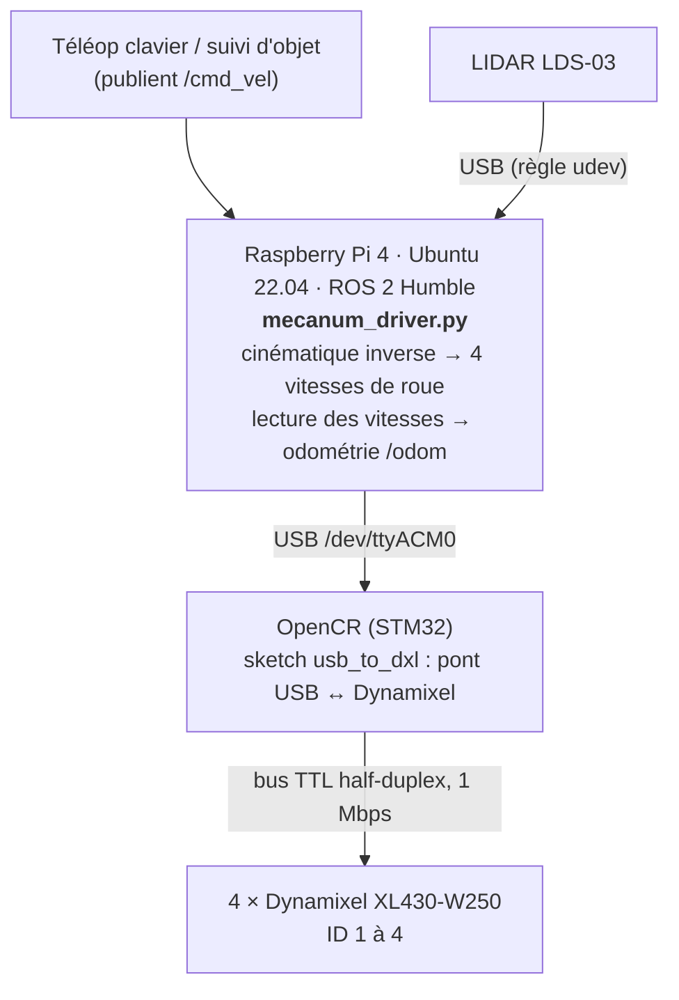
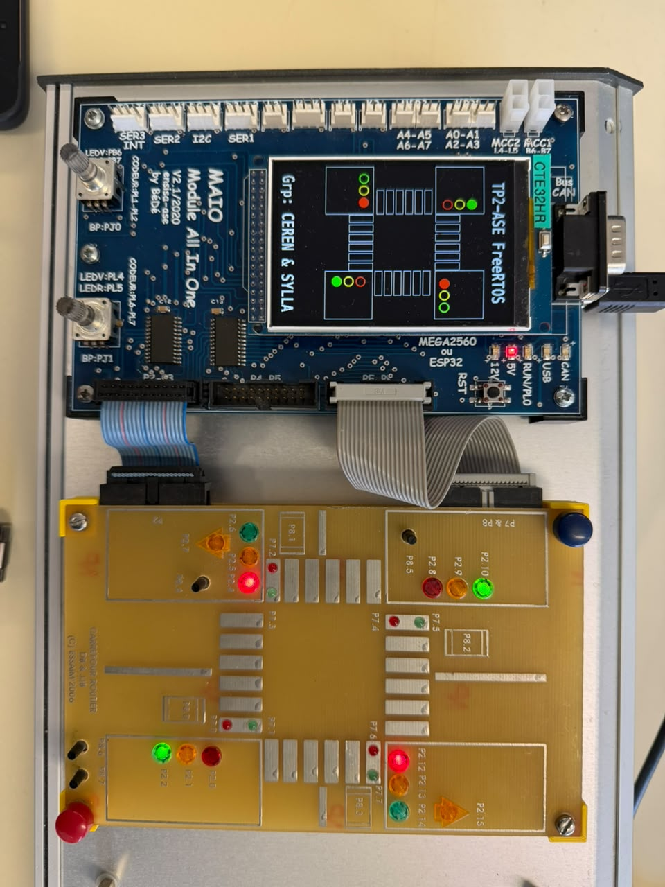
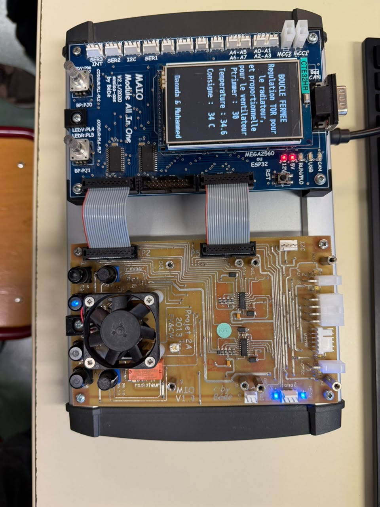
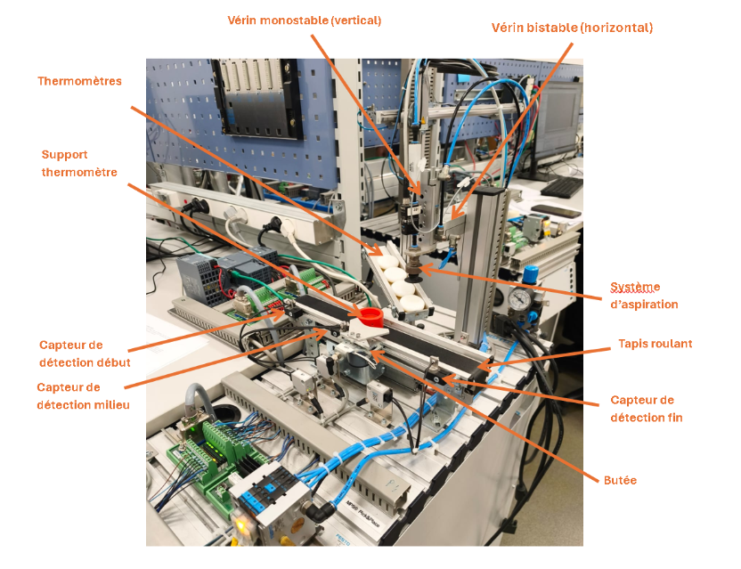
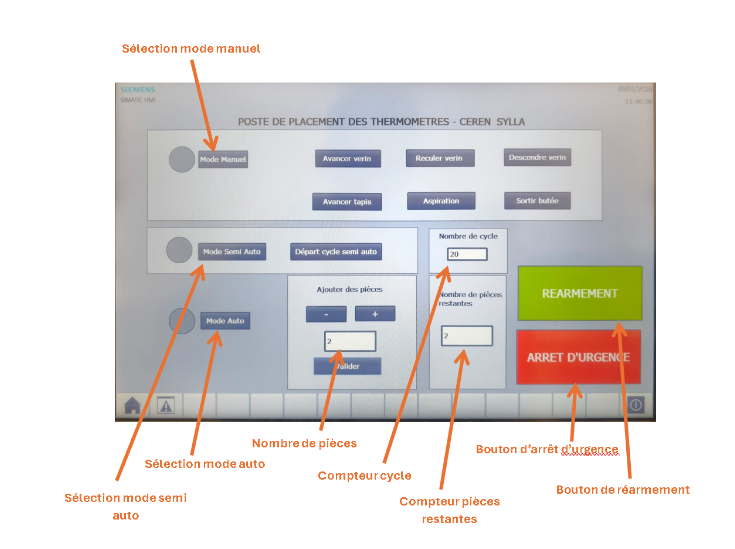

# Daouda SYLLA — Portfolio de projets d'ingénierie

**Élève-ingénieur en 3e année · ENSISA (Mulhouse) · Automatique & Systèmes Embarqués**

*Robotique mobile · Logiciel embarqué C/C++ & Python · Linux & ROS 2 · Électronique · Contrôle-commande*

**🎯 Recherche un stage de fin d'études de 6 mois à partir de mars 2027** 
systèmes embarqués · robotique · contrôle-commande · test & validation

[✉️ daoudesylla@gmail.com](mailto:daoudesylla@gmail.com) · [💼 LinkedIn](https://linkedin.com/in/sylla-daouda) · [🐙 GitHub](https://github.com/EngS1)

---

## En un coup d'œil

| | Projet | Ce que j'y ai fait | Technologies |
|---|---|---|---|
| 🤖 | [**Flotte de robots TurtleBot3 Mecanum**](#1-flotte-de-robots-omnidirectionnels-turtlebot3-mecanum) | Pilote ROS 2 de 4 moteurs, cinématique mecanum, odométrie étalonnée, LIDAR, suivi d'objet | ROS 2, Python, Linux, Dynamixel, LIDAR |
| 🚁 | [**Drone quadricoptère ArduPilot**](#2-drone-quadricoptère-pixhawk--ardupilot) | Montage, liaison MAVLink sous Linux, configuration et calibration | Pixhawk 6C, ArduCopter, MAVProxy |
| 🧠 | [**IA embarquée — robot ROMI**](https://github.com/EngS1/romi-gesture-control-uno-q) | Reconnaissance de gestes embarquée, pilotage temps réel | Arduino UNO Q, Zephyr, Python, C++ |
| ⚡ | [**Wattmètre numérique**](#3-wattmètre-numérique) | Carte conçue de A à Z : simulation, PCB, soudure, acquisition, traitement | LTspice, KiCad, C/C++ |
| ⏱️ | [**Régulation temps réel FreeRTOS**](#4-régulation-de-température-temps-réel-sous-freertos) | Application multitâche en C, régulation en boucle fermée | C, FreeRTOS, microcontrôleur |
| 🏭 | [**Automatisation d'un poste industriel**](#5-automatisation-dun-poste-de-placement) | 6 GRAFCET, modes de marche, sécurités, IHM | Siemens TIA Portal |
| 🧭 | [**Navigation autonome LIDAR**](#6-navigation-autonome-dun-robot-mobile-turtle-week-gobi) | Filtrage LIDAR, points de passage, évitement d'obstacles | TurtleBot3, LIDAR |

## Compétences

| Domaine | Outils et notions |
|---|---|
| **Logiciel embarqué** | C, C++, Python, Bash · FreeRTOS, Zephyr · STM32/ARM, Arduino, Raspberry Pi |
| **Robotique** | ROS 2 Humble (multi-machines, namespaces, launch, TF, RViz2) · cinématique de robots mobiles · odométrie · LIDAR |
| **Bus et protocoles** | CAN / CAN FD (DBC, Vector CANoe, CAPL) · Dynamixel protocole 2.0 · MAVLink · UART, SPI, I2C · Bluetooth |
| **Électronique** | Chaîne d'acquisition · LTspice · KiCad (schéma, PCB) · soudure · mise en service de cartes |
| **Automatique** | Modélisation, identification · PID, retour d'état, observateurs, commande robuste · MATLAB/Simulink |
| **Automatisme** | Siemens TIA Portal · GRAFCET, Ladder · IHM |
| **Outils** | Linux (Ubuntu), Git / GitLab / GitHub · SysML / MBSE |

---

## 1. Flotte de robots omnidirectionnels TurtleBot3 Mecanum

**Projet de 3e année · ENSISA 2026-2027 · en binôme avec Laurent Wolff · en cours**

  
   <em>Le TurtleBot3 transformé : 4 roues mecanum, Raspberry Pi 4, carte OpenCR et LIDAR LDS-03.</em>

### Objectif
Transformer un **TurtleBot3 Burger** (2 roues différentielles) en robot **omnidirectionnel à 4 roues mecanum**, puis construire une **flotte de 4 robots** capables de se déplacer ensemble et de percevoir leur environnement. Un robot mecanum peut avancer, se déplacer latéralement et tourner sur place sans manœuvre, ce qui est idéal pour le déplacement en formation.

### Résultats à ce jour
- ✅ Les 4 roues sont pilotées depuis ROS 2 : avance, déplacement latéral et rotation validés.
- ✅ Téléopération clavier, lancement en une commande, fichier de paramètres par robot.
- ✅ Odométrie à 20 Hz, **étalonnée** (écart de 1,75 % en ligne droite).
- ✅ LIDAR LDS-03 opérationnel et visualisé dans RViz2.
- 🔄 Suivi d'un objet au LIDAR (écrit, en test), puis suivi d'un robot meneur et flotte de 4 robots.

### Architecture

### Une décision d'architecture clé
Le firmware standard du TurtleBot3 ne pilote que **2 moteurs**. Nous avons d'abord essayé le firmware d'exemple `turtlebot3_mecanum` (piloté seulement à la télécommande, pas par ROS 2), puis la modification des sources du firmware et du nœud ROS, qui devaient rester cohérents et être reflashés sur chaque robot.

Nous avons finalement **déplacé toute la logique sur la Raspberry Pi** : l'OpenCR est reflashée avec le sketch `usb_to_dxl` et ne sert plus que de **pont USB ↔ Dynamixel**. Un nœud ROS 2 écrit en Python pilote directement les moteurs.

| Avantage | Pourquoi |
|---|---|
| **Isoler les pannes** | Plus de code embarqué intermédiaire : une roue qui ne tourne pas vient du câblage, du moteur ou du script. |
| **Itérer vite** | On modifie un fichier Python et on relance, sans recompiler ni reflasher. |
| **Dupliquer facilement** | Les 4 robots partagent le même pont et le même script, avec des paramètres différents. |

### Ce que fait le pilote `mecanum_driver.py`
- **Configuration des moteurs** (IDs, baudrate à 1 Mbps, mode vitesse, sens inversé pour le moteur monté en miroir), avec la *control table* du protocole Dynamixel 2.0.
- **Cinématique inverse** : conversion de la consigne `/cmd_vel` (vx, vy, ωz) en vitesse de chaque roue.
- **Limitation proportionnelle** : si une roue dépasse la vitesse max, toutes les roues sont réduites dans le même rapport pour conserver la direction.
- **Envoi groupé `SyncWrite`** : les 4 roues démarrent en même temps, indispensable en mecanum.
- **Chien de garde** : sans commande pendant 0,5 s, le robot s'arrête.
- **Odométrie** : lecture groupée des vitesses réelles (`GroupSyncRead`) à 20 Hz, cinématique directe, intégration de la position, publication de `/odom` et de la transformation `odom → base_footprint`.

**Cinématique inverse** (rouleaux en X, `k = lx + ly`, `r` le rayon de roue) :

$$\omega_{FL}=\frac{v_x-v_y-k\,\omega_z}{r}\quad \omega_{FR}=\frac{v_x+v_y+k\,\omega_z}{r}\quad \omega_{RL}=\frac{v_x+v_y-k\,\omega_z}{r}\quad \omega_{RR}=\frac{v_x-v_y+k\,\omega_z}{r}$$

### Étalonnage de l'odométrie

| Axe | Mesure | Correction |
|---|---|---|
| Avance | 1,0175 m affiché pour 1,00 m réel | écart de 1,75 %, non corrigé |
| Latéral | glissement des rouleaux, plusieurs essais | facteur 0,975 |
| Rotation | 1049° affichés pour 3 tours (1080°) | facteur 1,03 |

### LIDAR et suivi d'objet
- Identification du bon modèle (**LDS-03**, et non LDS-02) après plusieurs essais de pilotes.
- **Règle udev** pour un nom de port fixe, transformation statique vers `base_scan`, réglage de la QoS *Best Effort* dans RViz2.
- **Suivi d'objet** (`object_follower.py`) : filtrage des points par distance, regroupement des points voisins, choix du groupe le plus proche, puis commande proportionnelle en translation pure grâce aux roues mecanum.

### Difficultés résolues (extrait)

| Symptôme | Cause | Solution |
|---|---|---|
| Seuls les moteurs 1 et 2 détectés | Moteurs neufs tous en ID 1 / 57 600 bps | Configuration un par un : baudrate, puis ID, puis mode |
| Une roue tourne à l'envers | Moteur monté en miroir | *Drive Mode* inversé sur ce moteur |
| Échec du flash de l'OpenCR (`0xF020`) | Bootloader, port ou câble | Mode recovery, bon port, câble data, groupe `dialout` |
| `Port is in use!` à l'arrêt | Ctrl+C au milieu d'un échange | Libération du port puis envoi des ordres d'arrêt |
| `/scan` vide | Mauvais pilote LIDAR | Pilote `coin_d4_driver` pour le LDS-03 |

**Méthode :** valider chaque couche avant la suivante (moteurs → port USB → script → téléop → odométrie), changer une seule chose à la fois, et tout documenter. La documentation du projet fait **22 pages**.

### Prochaines étapes
Suivi d'un robot meneur au LIDAR · modèle URDF · namespaces par robot pour la flotte · déplacement en formation · SLAM et navigation (Nav2) · fusion odométrie + IMU.

**Compétences :** ROS 2 · Python · Linux · protocole Dynamixel · cinématique de robots mobiles · odométrie · LIDAR · débogage matériel/logiciel · documentation technique · travail en binôme.

---

## 2. Drone quadricoptère Pixhawk / ArduPilot

**Projet personnel · plateforme pour progresser sur les engins volants et ROS 2**

| | |
|---|---|
|  |  |

### Matériel
Kit **B-CUBE** à cadre carbone **450**, moteurs **2212**, ESC **BLHeli 30 A**, télémétrie radio **100 mW**, GPS. Le kit était annoncé avec un Pixhawk 2.4.8 ; le journal de démarrage a révélé un **Pixhawk 6C** sous **ArduCopter 4.4.4**.

### Réalisé
- Montage du drone et du module de puissance.
- Liaison **MAVLink** avec le contrôleur de vol depuis Linux via **MAVProxy** (USB, `ttyACM0`), après des problèmes de compatibilité des stations sol sur ma distribution.
- Identification de la carte et du firmware à partir des journaux, configuration du frame (**QUAD/X**).
- Calibration de l'**accéléromètre** et du **compas**.

### Prochaines étapes
Radiocommande, premiers essais, puis **ordinateur compagnon** (Arduino UNO Q) pour développer sous ROS 2 et embarquer de l'IA.

**Compétences :** intégration matérielle · ArduPilot · MAVLink · Linux · diagnostic à partir de journaux.

---

## 3. Wattmètre numérique

**Projet de 1re année · conception d'un instrument de mesure, du cahier des charges à la visualisation**

| | | |
|---|---|---|
|  |  |  |

### Démarche
1. **Cahier des charges** : exigences et contraintes de l'instrument.
2. **Architecture** : découpage de la chaîne de mesure en blocs fonctionnels.
3. **Simulation LTspice** : validation des circuits avant fabrication.
4. **Schéma et PCB sous KiCad** : conception, placement, routage.
5. **Réalisation et soudure** de la carte.
6. **Acquisition** des données par le microcontrôleur.
7. **Traitement numérique du signal** en C/C++ : calcul des grandeurs à partir des échantillons.
8. **Visualisation** et validation des mesures.

**Compétences :** chaîne d'acquisition · simulation de circuits · conception de PCB · soudure · C/C++ embarqué · traitement du signal · intégration matériel/logiciel.

---

## 4. Régulation de température temps réel sous FreeRTOS

**TP de systèmes temps réel (ASE) · carte MAIO · réalisé en binôme avec Muhammed CEREN**

| | |
|---|---|
|  |  |
| *Carte MAIO et sa carte d'extension pendant le TP FreeRTOS* | *Régulation en boucle fermée proportionnelle : consigne 30 °C* |

### Ce que nous avons développé
- Application en **C** décomposée en **tâches concurrentes** sous FreeRTOS.
- Gestion des **priorités** et de la **préemption**.
- **Synchronisation** et **communication inter-tâches** (sémaphores, échanges de données).
- **Régulation en boucle fermée** de la température d'un radiateur, avec affichage de la consigne et de la mesure.
- Tests des interactions entre tâches.

**Compétences :** C embarqué · FreeRTOS · temps réel · régulation · microcontrôleur.

---

## 5. Automatisation d'un poste de placement

**TP d'automates programmables (2A ASE) · Siemens TIA Portal, GRAFCET, IHM · réalisé en binôme avec Muhammed CEREN**

| | |
|---|---|
|  |  |
| *Vue d'ensemble du poste de placement* | *Interface de supervision (IHM)* |

### Contexte
Automatisation du **poste 4 (Placement)** d'une ligne d'assemblage de thermomètres : le poste insère un thermomètre sur un support plastique, avec un **convoyeur** et un **manipulateur pneumatique 2 axes**.

### Architecture : 6 GRAFCET indépendants

| GRAFCET | Rôle |
|---------|------|
| **Sélection de marche** | Orchestre les modes Auto, Semi-Auto, Manuel et Réarmement |
| **Auto — Tâche 1** | Manipulateur (prise, transfert, dépose, retour) |
| **Auto — Tâche 2** | Tapis (arrivée, butée, évacuation, comptage du lot) |
| **Semi-Auto — Tâche 1** | Manipulateur, une séquence par départ cycle |
| **Semi-Auto — Tâche 2** | Tapis, traitement d'une pièce unique |
| **Manuel** | Pilotage de chaque actionneur, avec interdictions de sécurité |

<b>Détails : modes de marche, synchronisation et sécurités</b>

- **Auto / Semi-Auto** : activables uniquement depuis les **conditions initiales** (vérins rentrés et en haut).
- **Manuel** : accessible à tout moment ; il désactive les autres modes pour éviter les conflits d'actionneurs.
- **Arrêt d'urgence et réarmement** : l'arrêt d'urgence bloque le système ; le réarmement le ramène à l'état initial.
- **Synchronisation** : le manipulateur attend le signal `Synchro_tache_tapis` ; le tapis autorise la dépose quand la pièce est en butée (`Presence_piece_milieu`).
- **Vérin de descente monostable** : son action est maintenue dans les étapes concernées.
- **Comptage** : un compteur décrémente le lot de 4 pièces ; à 0, le cycle s'arrête.
- **Sécurités en manuel** : par exemple, la sortie du vérin horizontal n'est possible que si `fdc_verin_haut` est actif.
- **IHM** : sélection du mode et visualisation de l'état des étapes en temps réel.

**Compétences :** TIA Portal · GRAFCET · Ladder · IHM · modes de marche · sécurité · synchronisation de tâches.

---

## 6. Navigation autonome d'un robot mobile (Turtle Week Gobi)

**Projet de 1re année · ENSISA 2024-2025 · équipe de 4 · robot TurtleBot3 équipé d'un LIDAR**

  

- **Perception** : acquisition LIDAR, filtrage des mesures dans un rayon de **40 cm**, isolement des obstacles proches et calcul d'un **point moyen** qui les caractérise.
- **Navigation** : repère local centré sur la position initiale, déplacement par **points de passage** puis **retour à l'origine**.
- **Évitement** : contournement des obstacles rencontrés sur le chemin vers chaque cible.

**Compétences :** LIDAR · filtrage de données capteur · navigation autonome · évitement d'obstacles · travail en équipe.

---

## Autres réalisations

| Projet | Description | Outils |
|--------|-------------|--------|
| **[IA embarquée — robot ROMI](https://github.com/EngS1/romi-gesture-control-uno-q)** | Pilotage d'un robot mobile par reconnaissance gestuelle : modèle d'IA exécuté sur Arduino UNO Q (processeur Linux + microcontrôleur sous Zephyr), commande par Bluetooth | Python, C++, Zephyr |
| **Pilotage distribué sur bus CAN — robot ROMI** | Architecture CAN distribuée, base DBC et messages multiplexés, scripts CAPL, tableau de bord virtuel (signalisation, télémétrie batterie, groupe motopropulseur) | Vector CANoe, CAPL, C++ |
| **Imagerie multispectrale instantanée** | Outil Python de traitement d'une caméra 9 bandes : lecture de données brutes (Mono8, 10p, 12p), démosaïquage, rendu couleur, moyennage temporel, ~20 ms/image pour une cadence de 25 ms *(dépôt GitLab de l'école)* | Python, Git |
| **Identification et commande d'un Twin Rotor** | Identification expérimentale d'un système MIMO, analyse des couplages et des perturbations, synthèse d'une commande robuste | MATLAB/Simulink |
| **[Vision+ — modélisation SysML](https://github.com/EngS1/vision-plus-sysml)** | Modélisation d'une aide à la mobilité pour personnes malvoyantes : exigences, cas d'utilisation, BDD, IBD, séquences | SysML, MBSE |
| **[MeetingPro](https://github.com/EngS1/Projet_CEREN_SYLLA)** | Application de réservation de salles avec interface graphique, en binôme | Python, tkinter |
| **Travaux de contrôle-commande** | Synthèse de correcteurs, retour d'état, identification de systèmes | MATLAB/Simulink, SISOTOOL |

---

## Parcours

- 🎓 **ENSISA** — Diplôme d'ingénieur, Automatique & Systèmes Embarqués (2024-2027)
- 🎓 **Gazi University** (Ankara) — Bachelor Génie Électrique et Électronique (2019-2023)
- 🔬 **Mines Saint-Étienne** — Stagiaire R&D en microélectronique (2022)
- 🤖 **International Maarif Schools** (Côte d'Ivoire) — Formateur robotique & STEM, 120+ élèves (2024)
- 🏭 **Stellantis** (Mulhouse) — Stagiaire production & logistique (2025)

🌍 Français (natif) · Anglais B2 (IELTS) · Turc (courant) · Arabe (débutant)

---

**Un projet vous intéresse ? Je serai ravi d'en parler.** 
[daoudesylla@gmail.com](mailto:daoudesylla@gmail.com) · [LinkedIn](https://linkedin.com/in/sylla-daouda)

