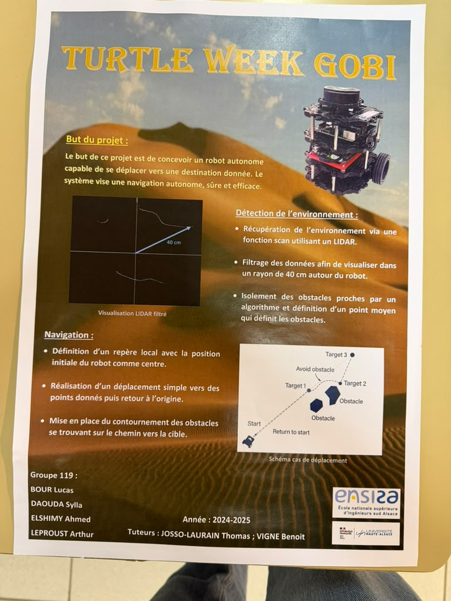
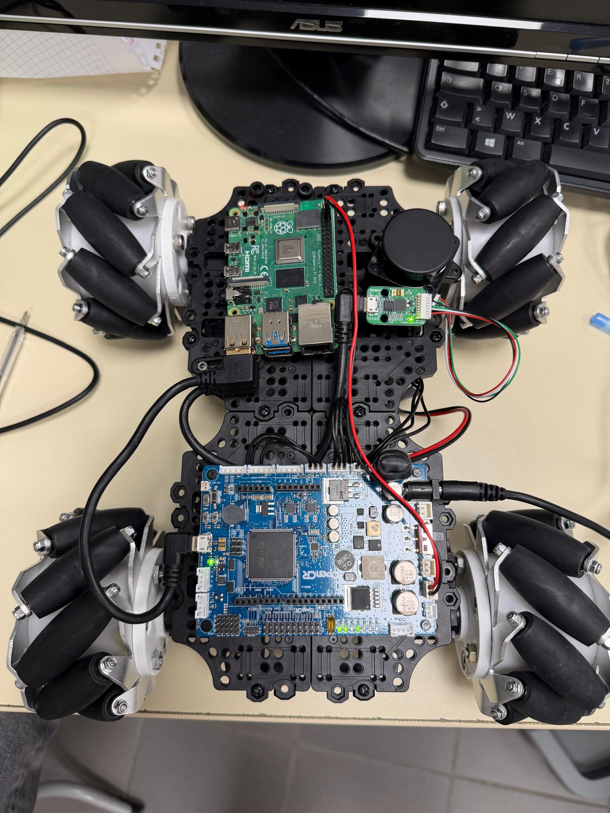
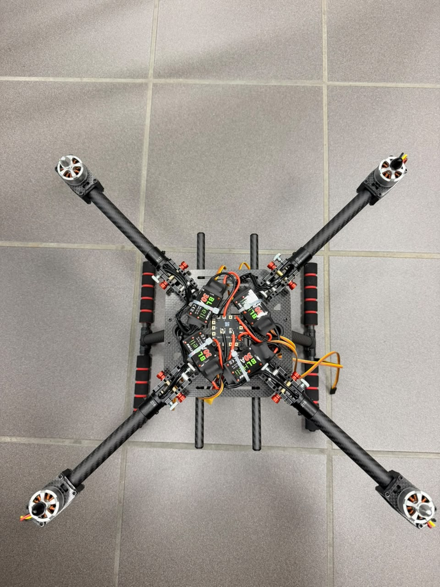
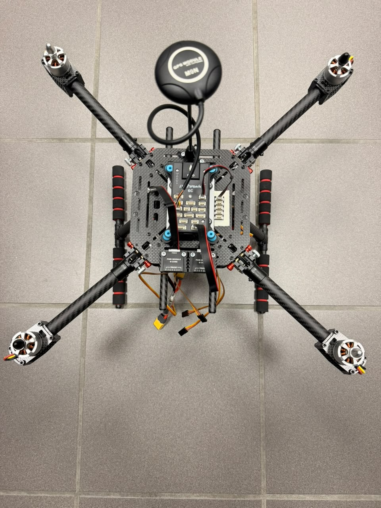
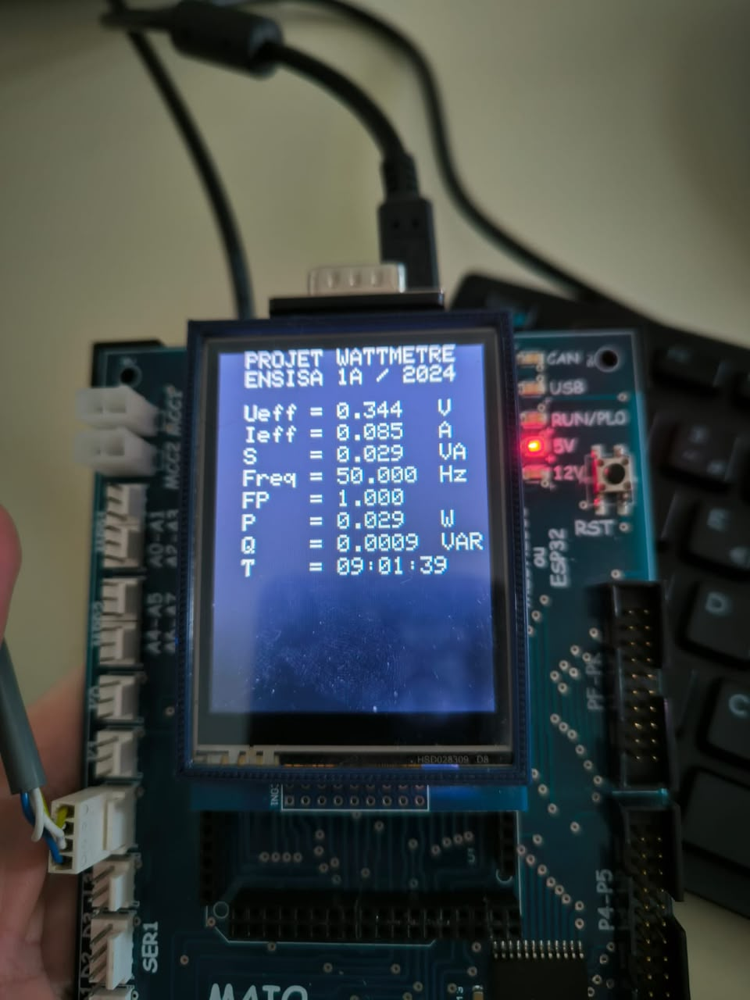
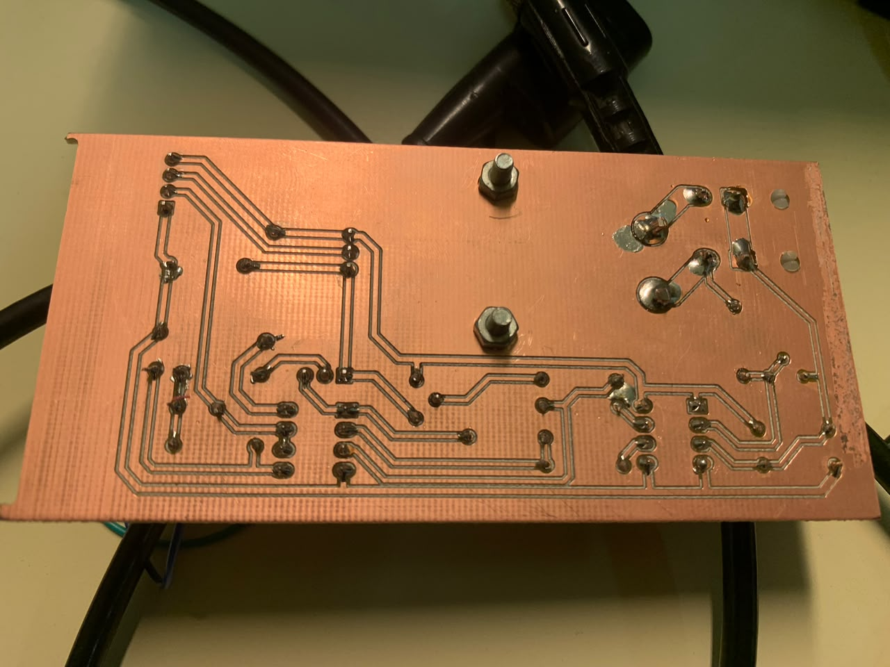
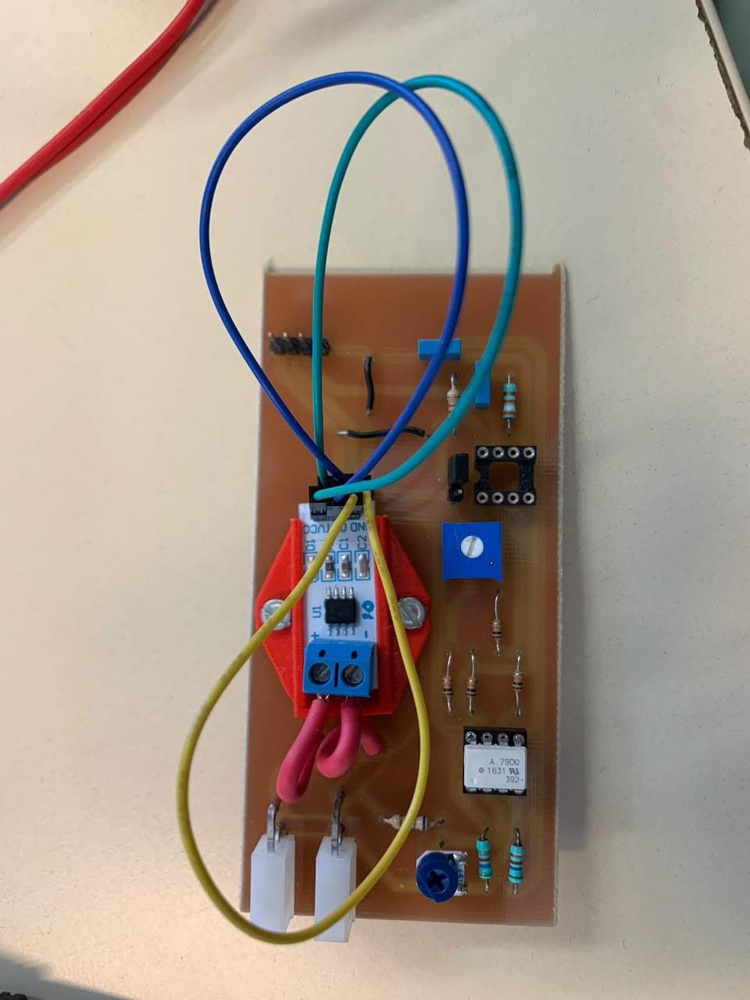

# Portfolio de projets d'ingénierie — Daouda SYLLA

Élève-ingénieur en 3e année à l'**ENSISA** (Mulhouse), spécialité **Automatique et Systèmes Embarqués**.
Ce dépôt présente, de façon détaillée, plusieurs de mes projets en robotique, électronique, automatisation et systèmes embarqués.

**Contact :** daoudesylla@gmail.com · [LinkedIn](https://linkedin.com/in/sylla-daouda) · [GitHub](https://github.com/EngS1)

## Sommaire

| # | Projet | Domaine | Outils |
|---|--------|---------|--------|
| 1 | [Navigation autonome d'un robot mobile (Turtle Week Gobi)](#1-navigation-autonome-dun-robot-mobile-turtle-week-gobi) | Robotique mobile, perception LIDAR, navigation | LIDAR, évitement d'obstacles |
| 2 | [TurtleBot3 Mecanum, plateforme omnidirectionnelle à 4 roues](#2-turtlebot3-mecanum-plateforme-omnidirectionnelle-à-4-roues) | Robotique mobile, cinématique, systèmes embarqués | TurtleBot3, OpenCR, ROS 2, Dynamixel |
| 3 | [Drone quadricoptère ArduPilot / ROS 2](#3-drone-quadricoptère-ardupilot--ros-2) | Robotique aérienne, systèmes embarqués | Pixhawk, ArduPilot, ROS 2 |
| 4 | [Wattmètre numérique](#4-wattmètre-numérique) | Électronique, acquisition, traitement du signal | LTspice, KiCad, C/C++ |
| 5 | [Automatisation d'un poste de placement](#5-automatisation-dun-poste-de-placement) | Automatisation industrielle | Siemens TIA Portal, GRAFCET, IHM |
| 6 | [Autres réalisations](#6-autres-réalisations) | Contrôle-commande, systèmes embarqués, IA embarquée | Matlab/Simulink, FreeRTOS, Vector CANoe |

---

## 1. Navigation autonome d'un robot mobile (Turtle Week Gobi)

**Projet de 1re année · ENSISA 2024-2025 · groupe 119, 4 étudiants · robot mobile équipé d'un LIDAR**



### Objectif
Concevoir un robot autonome capable de se déplacer vers une destination donnée, avec une navigation sûre et efficace.

### Perception de l'environnement
- **Acquisition LIDAR** : récupération de l'environnement par une fonction de scan.
- **Filtrage des données** : seules les mesures situées dans un rayon de **40 cm** autour du robot sont conservées et visualisées.
- **Détection des obstacles proches** : un algorithme isole les obstacles et définit un **point moyen** qui les caractérise.

### Navigation
- **Repère local** : la position initiale du robot sert d'origine.
- **Déplacement par points de passage** : le robot rejoint des points donnés, puis **revient à l'origine**.
- **Contournement d'obstacles** : le robot évite les obstacles rencontrés sur le chemin vers la cible.

### Scénario de déplacement
Départ, passage par trois cibles successives avec obstacles à contourner entre elles, puis retour au point de départ.

### Compétences mobilisées
Perception par LIDAR · filtrage de données capteur · détection d'obstacles · navigation autonome · évitement d'obstacles · travail en équipe.

**Projets liés :** [TurtleBot3 Mecanum, plateforme omnidirectionnelle à 4 roues](#2-turtlebot3-mecanum-plateforme-omnidirectionnelle-à-4-roues) · [pilotage gestuel du robot ROMI avec détection d'obstacles](https://github.com/EngS1/romi-gesture-control-uno-q) · [plateforme drone ArduPilot / ROS 2](#3-drone-quadricoptère-ardupilot--ros-2)

---

## 2. TurtleBot3 Mecanum, plateforme omnidirectionnelle à 4 roues

**Projet de 3e année · ENSISA 2026-2027 · en cours · travail en équipe · TurtleBot3 Burger, OpenCR, ROS 2**


*Premier robot monté : le TurtleBot3 Burger, base de départ du projet.*

### Objectif
Transformer un TurtleBot3 Burger (robot différentiel à 2 roues) en robot **omnidirectionnel à 4 roues Mecanum**, puis monter 3 autres robots et les faire fonctionner en parallèle sous ROS 2.

### Étapes du projet
1. Prise en main du TurtleBot3 Burger.
2. Recherche sur les roues omnidirectionnelles, en particulier les roues Mecanum.
3. Modification du robot pour passer à 4 roues Mecanum.
4. Étude technique de la logique de fonctionnement de ces roues.
5. Montage de 3 autres robots et mise en parallèle.

### Architecture
Clavier / scripts Python (`Twist` sur `/cmd_vel`) → Raspberry Pi (Ubuntu 22.04, ROS 2 Humble) → USB → **OpenCR** (STM32F7, firmware C++) → bus TTL Dynamixel → 4 moteurs Dynamixel.

### Réalisé à ce jour
- Prise en main du Burger : bringup ROS 2 et téléopération.
- Scripts Python ROS 2 : cercle, carré, pilotage aux flèches du clavier (boucle ouverte).
- Isolation des communications entre robots via `ROS_DOMAIN_ID`.
- Étude de la cinématique Mecanum.
- Chaîne de développement OpenCR sous Linux : IDE Arduino, paquet OpenCR, règles udev, droits du port série.
- Firmware ROBOTIS d'exemple `turtlebot3_mecanum` compilé et téléversé sur l'OpenCR (CRC vérifié), avec retour possible au firmware ROS 2 du Burger.
- Relecture critique du firmware d'exemple : points d'attention identifiés (saturations, gestion d'erreur du driver), non encore corrigés.

### En cours et à venir
- **En cours** : validation du matériel sur le nouveau châssis (IDs des moteurs, sens de rotation de chaque roue).
- **À venir** : firmware ROS 2 à 4 moteurs (prise en compte de `linear.y`), odométrie, modèle URDF, puis les 3 autres robots (un `ROS_DOMAIN_ID` par robot).
- **Perspectives (non réalisées)** : navigation autonome (SLAM, Nav2) et fusion odométrie + IMU pour compenser le glissement des roues Mecanum.

### Cinématique inverse Mecanum
Avec `vx` (avant), `vy` (latéral), `ω` (rotation), `r` le rayon de roue et `k = L + W` (demi-empattement + demi-voie) :

```
ω_AG = (vx - vy - k·ω) / r
ω_AD = (vx + vy + k·ω) / r
ω_RG = (vx + vy - k·ω) / r
ω_RD = (vx - vy + k·ω) / r
```

Convention : ROS prend +y vers la gauche ; le firmware d'exemple ROBOTIS utilise la convention opposée, à gérer lors de l'intégration ROS 2. Limites connues : glissement des rouleaux, sol lisse nécessaire, 4 roues pour 3 degrés de liberté (système surdéterminé).

### Difficultés rencontrées
- **Installation du paquet OpenCR 1.5.3** : l'archive publiée par ROBOTIS est au format gzip alors qu'elle est nommée `.tar.bz2`, ce qui fait échouer le gestionnaire de cartes (« Stream is not in the BZip2 format »). Diagnostic avec `file`, puis extraction manuelle.
- **IDE Arduino en snap** : dossier de données différent de `~/.arduino15`, accès au port série à configurer (`dialout`, règles udev).

### Compétences mobilisées
ROS 2 (Humble) · Python · C/C++ embarqué (OpenCR / Arduino) · bus Dynamixel · Linux · cinématique de robots mobiles · débogage système · travail en équipe.

**Projet lié :** [Navigation autonome d'un robot mobile (Turtle Week Gobi)](#1-navigation-autonome-dun-robot-mobile-turtle-week-gobi)

---

## 3. Drone quadricoptère ArduPilot / ROS 2

**Projet personnel · Monter une plateforme de drone pour progresser en ROS 2 et sur les engins volants**

| | |
|---|---|
|  |  |

### Objectif
Acquérir des compétences sur les engins volants et approfondir ROS 2 sur une plateforme réelle, que je monte et configure moi-même.

### Matériel
- Kit quadricoptère **B-CUBE** : contrôleur de vol **Pixhawk 2.4.8** (firmware **ArduPilot**), cadre carbone **450**
- Moteurs **2212** et contrôleurs de vitesse (ESC) **BLHeli 30 A**
- Télémétrie radio **100 mW**

### Avancement et architecture visée
- **Montage matériel** : en cours de finalisation.
- **Ordinateur de bord (companion computer)** : ajout prévu à la plateforme pour développer sous ROS 2 et embarquer de l'intelligence artificielle.

### Compétences visées
Intégration matériel d'un drone · ArduPilot · ROS 2 · IA embarquée · systèmes autonomes.

---

## 4. Wattmètre numérique

**Projet de 1re année · Conception d'un instrument de mesure, du cahier des charges à la visualisation des mesures**

| | | |
|---|---|---|
|  |  |  |

### Objectif
Réaliser un wattmètre numérique complet en suivant toutes les étapes d'un projet d'ingénierie, de l'analyse du besoin jusqu'à l'exploitation des mesures.

### Démarche
1. **Analyse du cahier des charges** : identification des exigences et des contraintes de l'instrument.
2. **Architecture technique** : découpage de la chaîne de mesure en blocs fonctionnels.
3. **Simulation sous LTspice** : validation du fonctionnement des circuits avant fabrication.
4. **Schématique sous KiCad** : reprise et finalisation de la conception électronique.
5. **Conception du PCB sous KiCad** : placement, routage et préparation de la carte.
6. **Réalisation et soudure** de la carte.
7. **Acquisition des données** par le système embarqué.
8. **Traitement du signal numérique** (C/C++) : calcul des grandeurs à partir des échantillons acquis.
9. **Visualisation** des mesures et des résultats après calcul.

### Compétences mobilisées
Conception de chaîne d'acquisition · simulation de circuits · conception de PCB · soudure · programmation C/C++ embarquée · traitement numérique du signal · intégration matériel/logiciel.

---

## 5. Automatisation d'un poste de placement

**TP d'automates programmables (2A ASE) · Siemens TIA Portal, GRAFCET, IHM · réalisé en binôme avec Muhammed CEREN**

| | |
|---|---|
|  |  |
| *Vue d'ensemble du poste de placement* | *Interface de supervision (IHM)* |

### Contexte
Automatisation du **poste 4 (Placement)** d'une ligne d'assemblage de thermomètres : le poste insère un thermomètre sur un support plastique. Le système comprend un **convoyeur** pour le flux des pièces et un **manipulateur pneumatique 2 axes** pour la prise et la dépose.

### Architecture de programmation
Le programme, développé sous **TIA Portal**, est découpé en **6 GRAFCET** indépendants pour obtenir une gestion modulaire et sécurisée :

| GRAFCET | Rôle |
|---------|------|
| **Sélection de marche** | Orchestre les modes Auto, Semi-Auto, Manuel et Réarmement |
| **Auto — Tâche 1** | Manipulateur (prise, transfert, dépose, retour) |
| **Auto — Tâche 2** | Tapis (arrivée des pièces, butée, évacuation, comptage du lot) |
| **Semi-Auto — Tâche 1** | Manipulateur, une seule séquence par ordre de départ cycle |
| **Semi-Auto — Tâche 2** | Tapis, traitement d'une pièce unique |
| **Manuel** | Pilotage individuel de chaque actionneur, avec interdictions de sécurité |

### Gestion des modes
- **Auto / Semi-Auto** : activables uniquement depuis les **conditions initiales** (vérins rentrés et en haut).
- **Manuel** : accessible à tout moment ; il désactive les autres modes pour éviter les conflits d'actionneurs.
- **Arrêt d'urgence et réarmement** : un appui sur l'arrêt d'urgence bloque le système ; le bouton de réarmement le ramène à l'état initial.

### Mode automatique (production normale)
- **Manipulateur (tâche 1)** : prise (descente et aspiration), attente du signal `Synchro_tache_tapis`, transfert horizontal avec maintien de l'aspiration, dépose (descente et coupure de l'aspiration), retour en position initiale.
- Le **vérin de descente est monostable** : son action est maintenue dans les étapes concernées pour qu'il reste en bas.
- **Tapis (tâche 2)** : le tapis avance jusqu'à la détection d'une pièce contre la butée (`Presence_piece_milieu`) et autorise alors la dépose. Une fois la pose terminée, la butée s'escamote et le tapis évacue la pièce.
- **Comptage** : un compteur décrémente le lot (4 pièces) ; à 0, le cycle s'arrête. Les pièces d'approvisionnement sont comptées depuis l'IHM, le poste n'ayant pas de capteur de présence pour le thermomètre.
- Les deux tâches sont **synchronisées** par échange de signaux entre GRAFCET.

### Mode semi-automatique (cycle par cycle)
Destiné au réglage et à la validation unitaire : le système s'arrête après chaque pièce et attend une nouvelle impulsion **Départ Cycle** depuis l'IHM. La cinématique est identique au mode automatique, mais les GRAFCET sont indépendants et sans notion de lot.

### Mode manuel et sécurités
Chaque actionneur est piloté depuis l'IHM. Des équations logiques interdisent les actions dangereuses : par exemple, la sortie du vérin horizontal n'est possible que si le capteur `fdc_verin_haut` est actif, ce qui protège la butée et le manipulateur.

### Supervision (IHM)
L'IHM permet de **sélectionner le mode** (ce qui active le GRAFCET correspondant) et de **visualiser l'état des étapes en temps réel**. Ce TP a été ma première programmation d'IHM.

### Compétences mobilisées
Programmation d'automate sous TIA Portal · modélisation en GRAFCET · logique Ladder · conception d'IHM · gestion des modes de marche · sécurité des opérateurs et du matériel · synchronisation de tâches.

---

## 6. Autres réalisations

| Projet | Description | Outils |
|--------|-------------|--------|
| **[IA embarquée pour le pilotage du robot ROMI](https://github.com/EngS1/romi-gesture-control-uno-q)** | Pilotage d'un robot mobile par reconnaissance gestuelle, modèle d'IA exécuté sur Arduino UNO Q et commande par Bluetooth | Python, C++, Zephyr RTOS |
| **[MeetingPro](https://github.com/EngS1/Projet_CEREN_SYLLA)** | Application de réservation de salles avec interface graphique | Python, tkinter |
| **[Vision+ — modélisation SysML](https://github.com/EngS1/vision-plus-sysml)** | Modélisation SysML complète d'une aide à la mobilité pour personnes malvoyantes : exigences, cas d'utilisation, BDD, IBD, séquences | SysML, MBSE |
| **Pilotage distribué sur bus CAN — robot ROMI** | Modélisation et supervision d'un réseau multiplexé : analyse de messagerie, création de bases de données CAN, tableau de bord virtuel (signalisation, télémétrie batterie, groupe motopropulseur) | Vector CANoe, CAN, C++ |
| **Régulation de température temps réel** | Architecture multitâche avec gestion des priorités, préemption et synchronisation inter-tâches | C/C++, FreeRTOS |
| **Identification et commande d'un système Twin Rotor** | Identification expérimentale, modélisation dynamique, analyse des couplages et perturbations, synthèse d'une commande robuste | Matlab/Simulink |
| **Travaux de contrôle-commande** | Synthèse de correcteurs, retour d'état, identification de systèmes | Matlab/Simulink, SISOTOOL |
| **Projets de systèmes embarqués** | Programmation de microcontrôleurs, communication série et temps réel | C/C++ |
